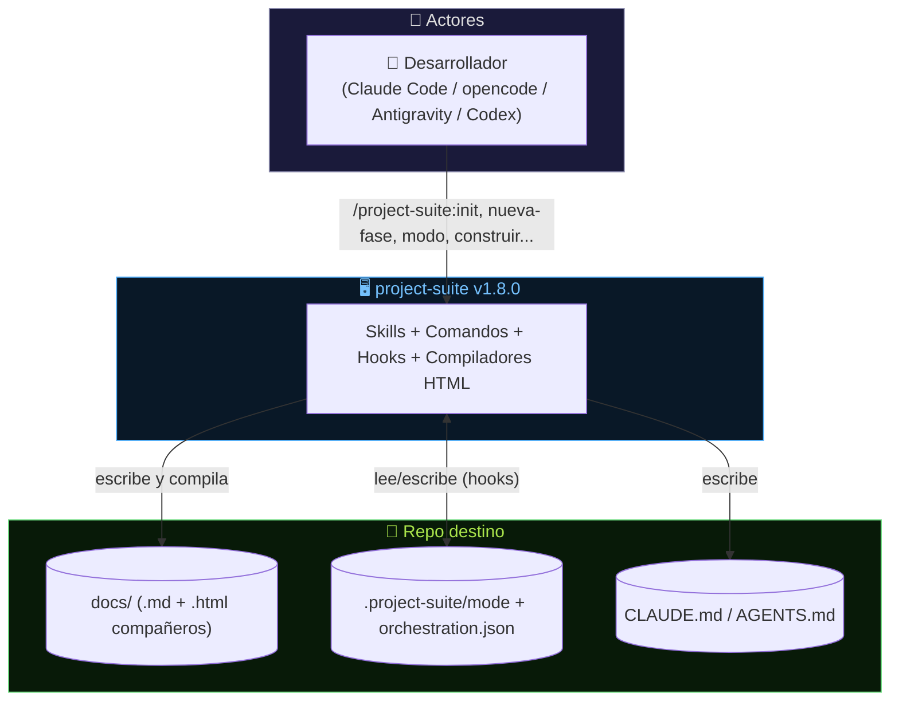
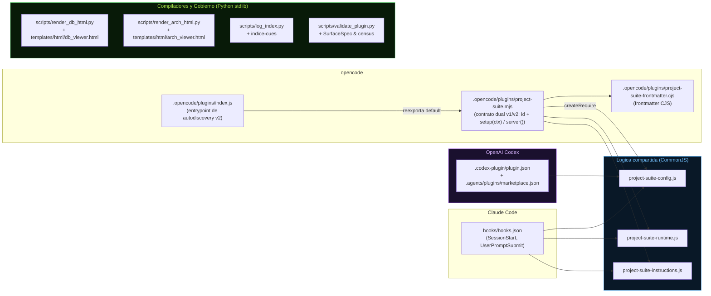
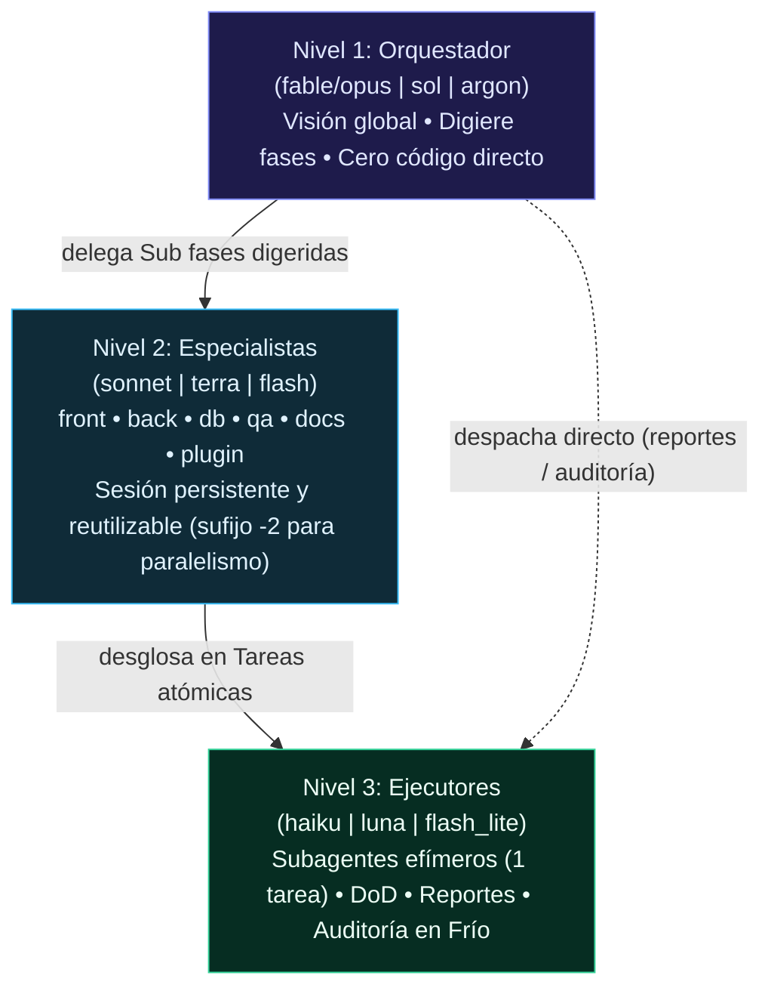
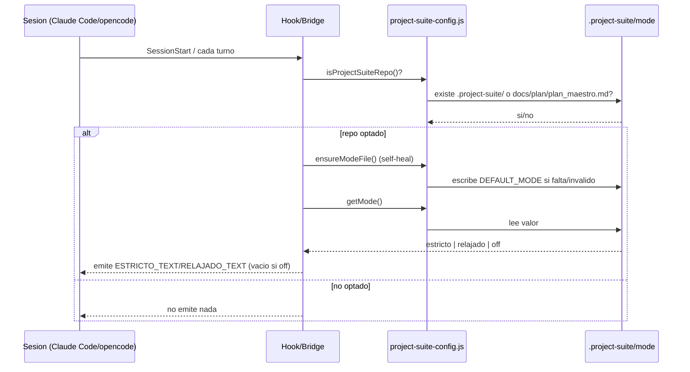
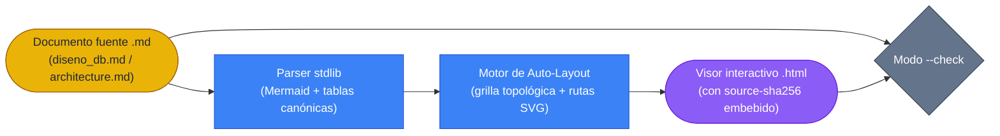
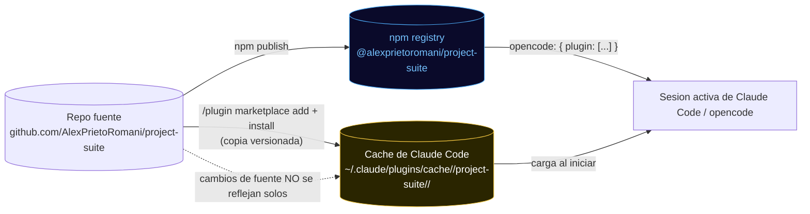

# Arquitectura — project-suite (v1.8.0)

> Este documento describe project-suite organizado por **flujos**: cómo un comando/skill produce un efecto real (archivos escritos, un visor HTML compilado, un hook disparado). Cuenta con su visor interactivo compañero en [`docs/architecture/architecture.html`](architecture.html) (compilado con `python scripts/render_arch_html.py`). El plan de construcción del plugin vive en `docs/plan/plan_maestro.md` y su tablero en `docs/task/tareas.md` (locales, gitignored, como en cualquier proyecto destino).

---

## 1. Visión General del Sistema (C4 – Nivel Contexto)

**Decisiones arquitectónicas clave (Nivel Macro):**
- El plugin no tiene servidor propio ni base de datos — es Markdown (skills/comandos) + Node.js (hooks) + Python (scripts de validación, sync y compiladores `.md` → `.html`), todo stdlib.
- Todo el estado que el plugin genera vive **en el repo destino**, no en el plugin mismo — auditable, versionable a criterio del usuario.
- La documentación de arquitectura y base de datos mantiene el `.md` como única fuente de verdad y compila visores HTML interactivos autocontenidos (`architecture.html` base Archify multi-vista y `diseno_db.html` base drawDB) verificables con `--check`.

## 2. Componentes Internos (C4 – Nivel Contenedor)

Una sola fuente de lógica (`hooks/project-suite-*.js`), dos entrypoints delgados por herramienta — evita duplicar la resolución de modo entre Claude Code y opencode. Los compiladores Python stdlib (`render_db_html.py` y `render_arch_html.py`) transforman `diseno_db.md` y `architecture.md` en visores HTML standalone sin requerir dependencias externas. Asimismo, `scripts/log_index.py` indexa la memoria de Cues transferibles en `docs/logs/log.md`, mientras `scripts/validate_plugin.py` audita el presupuesto context `always-on` (`SurfaceSpec`) y emite el censo cuantitativo de superficie (`--census`).

### 2.1 Puente dual de OpenCode (v1/v2)

El plugin de opencode se compone de 3 archivos hand-authored (el sync de `.opencode/` los preserva, no los regenera):

| Archivo | Rol |
|---|---|
| `.opencode/plugins/project-suite.mjs` | Plugin principal ESM con **contrato dual**: exporta por defecto `{ id: 'project-suite', async setup(ctx), async server({ client }) }`. `id` + `setup(ctx)` es el contrato **v2** — registra transformadores `ctx.skill.transform` y `ctx.command.transform` (comandos/skills desde `.opencode/command/*.md` y `skills/*/SKILL.md` vía el parser CJS, persistencia de `/modo` en `.project-suite/mode` y sustitución de `$ARGUMENTS`) y hooks de sesión `ctx.session.hook('context')` / `ctx.session.hook('compaction')` que inyectan el recordatorio ambiental si `isProjectSuiteRepo(root)` es verdadero. `server()` es el contrato **v1** — retorna los hooks equivalentes para el binario opencode anterior. |
| `.opencode/plugins/index.js` | Entrypoint de **autodiscovery v2** — reexporta el `default` desde `./project-suite.mjs`; OpenCode v2 descubre plugins locales por convención buscando `index.js`, sin necesidad de registrarlo en `opencode.json`. |
| `.opencode/plugins/project-suite-frontmatter.cjs` | Parser **desacoplado** de frontmatter YAML (CommonJS) — expone `parseCommandFile(content)` y `parseSkillFile(content)` con soporte de saltos CRLF y escalares de bloque `>` / `|`; el `.mjs` lo consume vía `createRequire` manteniendo una única export por defecto. |

### 2.2 Orquestación Jerárquica en 3 Niveles (`Orquestador -> Especialista -> Ejecutor`)

La arquitectura de ejecución y gobernanza de `project-suite` organiza el trabajo en una jerarquía estricta de tres niveles, documentada en [`skills/construir/references/orquestacion-3-niveles.md`](../../skills/construir/references/orquestacion-3-niveles.md) y persistida en `.project-suite/orchestration.json`:

| Nivel | Rol y Alcance | Reglas de Ciclo de Vida |
|---|---|---|
| **Nivel 1 — Orquestador** | Sesión principal del usuario. Mantiene la visión estratégica del proyecto, digiere las Fases y Sub fases del Plan Maestro antes de delegarlas y evalúa los entregables devueltos. **No escribe código de aplicación directamente**. | Coordina el flujo global. Puede lanzar directamente subagentes de Nivel 3 (Ejecutores) para reportes, validaciones de DoD o Auditorías en Frío sin ensuciar su contexto. Excepcionalmente lanza Nivel 2 si requiere razonamiento pesado. |
| **Nivel 2 — Especialista** | Sesiones persistentes por dominio (`front`, `back`, `db`, `qa`, `docs`, `plugin`). Recibe del Orquestador Fases o Sub fases ya digeridas con contratos y Criterios de Aceptación (AC) acotados. | **Reutilización obligatoria:** siempre se reutiliza la misma sesión/chat del especialista para todas las tareas de su dominio. Solo se lanza un segundo especialista con sufijo `-2` (ej. `front-2`) al paralelizar procesos simultáneos del mismo dominio. |
| **Nivel 3 — Ejecutor** | Subagentes rápidos, ligeros y efímeros con contexto mínimo para una sola tarea o acción atómica. | Lanzados por el Especialista (para resolver Tareas pequeñas) o por el Orquestador (para reportes puntuales, validaciones o Auditorías en Frío). Nacen, ejecutan la tarea y terminan liberando la ventana del nivel superior. |

#### Presets de Modelos por Agente

| Agente de Código | Nivel 1: Orquestador | Nivel 2: Especialista (`front`, `back`...) | Nivel 3: Ejecutor (Tareas / Reportes / Auditoría en Frío) |
|---|---|---|---|
| **Claude Code** | `fable` / `opus` | `sonnet` (Sonnet 5.5) | `haiku` (Haiku 5.5) *(fallback a `sonnet` solo si requiere razonamiento pesado)* |
| **Codex** | `sol` | `terra` | `luna` |
| **Antigravity** | `argon` (`pro`) | `flash` (Gemini 3.8 Flash, reutilizado por `conversationId`) | `flash_lite` (Flash Lite) o `flash` efímero de 1 sola tarea |
| **OpenCode** | Según proveedor activo (`opus` / `sol` / `argon` / `model`) | Modelo especialista (`sonnet` / `terra` / `flash` / `model`) | Modelo ejecutor (`haiku` / `luna` / `flash_lite` / `small_model`) |

#### Topologías y Política de Visibilidad (`.project-suite/orchestration.json`)

El archivo `.project-suite/orchestration.json` almacena `visibility` (`private` | `public`), `topology` y los presets configurados al inicio con `/init` (`scripts/scaffold_project.py`) o conmutados en vivo con `/modo orquestacion`:
- **Repositorio Privado (`visibility: "private"` -> `single-agent` por defecto):** Todo el flujo de 3 niveles corre **100% dentro del mismo agente de código** activo mediante sus subagentes nativos y reutilizando la sesión del Especialista. Protege la privacidad y compliance del código aislando la ejecución de cualquier herramienta externa.
- **Repositorio Público (`visibility: "public"` -> `multi-agent-orca` si se detecta Orca):** Permite combinar varios agentes de código simultáneamente. Si se detecta Orca (`ORCA_PANE_KEY` / `orca worktree current`), el Orquestador lanza y reutiliza terminales especialistas (`orca orchestration worker-start --keep-open` y `orca orchestration send`) con `opencode2`, `claude`, `codex` o `antigravity`.
- **Modo puente sin Orca (`multi-agent-bridge`):** Traspaso de contexto desacoplado mediante paquetes de handoff estructurados en `.project-suite/handoffs/<especialista>.md` y branches/worktrees con `python scripts/tablero.py --worktree`.

### 2.3 Auditoría en Frío (Zero-Context Review con Ejecutores)

Para combatir el **sesgo de autor** (releer especificaciones, planes o código con la intención mental acumulada en lugar de con lo que realmente está escrito), el Orquestador implementa el protocolo de **Auditoría en Frío** ([`skills/especificar/references/auditoria-en-frio.md`](../../skills/especificar/references/auditoria-en-frio.md)):
- **Mecanismo:** El Orquestador lanza de 1 a 3 subagentes **Ejecutores de Nivel 3** (`haiku`, `luna`, `flash_lite`) con **cero contexto previo** de la conversación, entregándoles únicamente el documento o el `git diff` a evaluar.
- **Las 3 Lentes de Auditoría:**
  1. **`zoom-out` (Simplicidad y YAGNI):** Identifica sobre-ingeniería, abstracciones prematuras y capas innecesarias preguntando cómo lograr el mismo objetivo con la mitad de piezas.
  2. **`comprehension` (Lectura Literal en Frío):** Evalúa con lectura limpia si el documento o diff es comprensible y autoexplicativo sin que el revisor tenga que adivinar supuestos. Si el Ejecutor interpreta algo distinto a lo planeado, el documento es ambiguo.
  3. **`design-critic` (Fallas, Bordes e Invariantes):** Busca condiciones de carrera, fallos silenciosos, invariantes de datos rotos, rutas o contratos incompatibles y casos borde no cubiertos por los tests declarados.
- **Matriz de Triage del Orquestador:** Los hallazgos se clasifican en `fix-now` (corrección inmediata antes de avanzar), `fix-in-fase` (anotación en el plan como tarea futura) o `descartar` (falso positivo fuera de alcance).
- **Puntos de Integración:** Opera como gate en `especificar`, `planificar`, `/nueva-fase` y `/review`.

### 2.4 Soporte Nativo para OpenAI Codex

Desde la versión **1.8.0**, project-suite cuenta con soporte nativo de primera clase para **OpenAI Codex**:
- **Manifiestos dedicados:** `.codex-plugin/plugin.json` y el catálogo `.agents/plugins/marketplace.json` exponen nativamente las 22 skills, los comandos y `.mcp.json` además de `AGENTS.md`.
- **Limpieza de configuración:** Se elimina la duplicación de `"plugin"` redundante en `opencode.json`, normalizando la convivencia de Codex con otros arneses.
- **Validación automatizada:** `scripts/validate_plugin.py` verifica la paridad entre los manifiestos de Claude Code, Antigravity, OpenCode y Codex garantizando coherencia en versión, descripciones y presupuesto de superficie context `always-on`.

---

## 🔄 Flujos de datos — mapa maestro

| # | Flujo | Entrada | Proceso | Salida |
|---|---|---|---|---|
| 1 | Scaffold inicial | `/init` | Entrevista + genera desde `templates/` + compila visores HTML | `docs/` (`.md` + `.html`), `CLAUDE.md`/`AGENTS.md`, `.gitignore`, `.mcp.json` |
| 2 | Gate de cambio nuevo | `/nueva-fase` | Evalúa y redacta Fase antes de codear | `plan_maestro.md` + `tareas.md` actualizados |
| 3 | Recordatorio ambiental | `SessionStart` / `UserPromptSubmit` | Resuelve modo, emite texto | Contexto de sesión / `.project-suite/mode` |
| 4 | Ejecución del plan | `construir` | Subagente por Tarea + `testear` + `verificar-dod` | Checkboxes `[X]` en `tareas.md`, commits |
| 5 | Sync multi-herramienta | `scripts/sync_opencode.py` | Espeja `skills/`/`commands/`/`.mcp.json` | `.opencode/`, `opencode.json` |
| 6 | Revision de diff | `/review` | Compara diff contra plan y spec | Reporte de desviaciones (sin modificar archivos) |
| 7 | Auditoria global | `/audit` | Recorre TODO el repo contra architecture/diseno_db y `--check` HTML | Reporte de drift (sin modificar archivos) |
| 8 | Compilación de visores HTML | `diseno_db.md` / `architecture.md` | Parsea Mermaid + tablas y auto-layoutea en `db_viewer.html` / `arch_viewer.html` | `diseno_db.html` (drawDB) y `architecture.html` (Archify) con sello SHA-256 |

## 3. Flujo 1 — Scaffold inicial (`init`)

**Entrada → Proceso → Salida:** entrevista de diseño → genera `docs/` (`.md` + `.html`) + reglas + gitignore → repo destino listo para planificar.

Script: `commands/init.md` (skills invocadas: `especificar`, `planificar`, `ejecucion`; scripts invocados: `scripts/scaffold_project.py`, `scripts/render_db_html.py`, `scripts/render_arch_html.py`).

### 3.2 Reglas e invariantes

| Regla | Descripción |
|---|---|
| Autosuficiencia de reglas | `CLAUDE.md`/`AGENTS.md` se generan cada uno con el cuerpo COMPLETO de `templates/generated/rules-body.tmpl.md` — nunca un puntero al otro. |
| Detección de herramienta | `echo $CLAUDE_PLUGIN_ROOT` decide el default sugerido de qué archivo generar, pero SIEMPRE se pregunta. |
| Archivos de trabajo locales por defecto | `docs/task/`, `docs/plan/`, `docs/logs/`, `CLAUDE.md`, `AGENTS.md`, `.project-suite/` van a `.gitignore` salvo `version_working_files: yes`. |

## 4. Flujo 2 — Gate de cambio nuevo (`nueva-fase`)

**Entrada → Proceso → Salida:** petición de cambio → decide si amerita Fase nueva → la redacta con Tareas y tests, sin codear.

Script: `commands/nueva-fase.md` (scripts invocados: `scripts/nueva_fase.py`, `scripts/tablero.py`).

### 4.2 Reglas e invariantes

| Regla | Descripción |
|---|---|
| Para antes de codear | El comando nunca escribe código de features — solo actualiza `plan_maestro.md`/`tareas.md`. |

## 5. Flujo 3 — Recordatorio ambiental de modo

**Entrada → Proceso → Salida:** evento de sesión o prompt del usuario → resuelve/persiste modo → texto de recordatorio o confirmación.

Scripts: `hooks/project-suite-activate.js` (SessionStart), `hooks/project-suite-mode-tracker.js` (UserPromptSubmit), `.opencode/plugins/project-suite.mjs` (equivalente opencode, dual v1/v2).

- **Claude Code:** los hooks `SessionStart` / `UserPromptSubmit` disparan los scripts de `hooks/` como siempre.
- **OpenCode v2:** `setup(ctx)` registra `ctx.session.hook('context')` y `ctx.session.hook('compaction')`, que inyectan el recordatorio en el system prompt de cada turno (el hook de compactación garantiza que el resumen no pierda el ruleset).
- **OpenCode v1:** `server()` retorna los hooks equivalentes para el binario anterior.
- La persistencia de `/modo <nivel>` en v2 es determinista: el `execute` de la transformación de comandos detecta la invocación de `modo` y persiste por código via `persistMode()`, sin depender del modelo.

### 5.1 Diagrama — resolución de modo y persistencia

### 5.2 Reglas e invariantes

| Regla | Descripción |
|---|---|
| Nunca toca repos no-opt-in | `isProjectSuiteRepo()` es el guard en ambos entrypoints, el bridge opencode (en `setup(ctx)` y `server()`) y en cada hook de sesión v2 (`context`/`compaction`). |
| Self-healing, no destructivo | Un archivo `.project-suite/mode` con contenido inválido se repara a `estricto`; uno válido (aunque no default) nunca se sobreescribe. |
| Deteccion determinista del cambio de modo | `UserPromptSubmit` regexea el prompt crudo (`^/project-suite:modo\b`) y persiste por código, sin depender de que el modelo obedezca. |
| Nunca lanza sin capturar | `setMode`/`ensureModeFile` envuelven sus operaciones de filesystem en try/except, degradando a `null`/`false` en vez de crashear la sesión. |

## 6. Flujo 4 — Ejecución del plan (`construir`)

**Entrada → Proceso → Salida:** `plan_maestro.md` + `tareas.md` → subagente por Tarea (jerarquía de 3 niveles: Orquestador -> Especialista -> Ejecutor) → checkbox `[X]` solo si `verificar-dod` pasa.

### 6.2 Reglas e invariantes

| Regla | Descripción |
|---|---|
| El checkbox es sagrado | Nunca se marca `[X]` sin que `verificar-dod` haya pasado en verde. |
| Jerarquía de 3 niveles | El Orquestador delega Sub fases digeridas al Especialista persistente (`front`, `back`, etc.), quien lanza Ejecutores efímeros (N3) para cada Tarea atómica. |
| Contexto acotado | Cada subagente recibe solo la Tarea + `*-standards` aplicables, no el plan completo. |

## 7. Flujo 5 — Sync multi-herramienta

**Entrada → Proceso → Salida:** `skills/`, `commands/`, `.mcp.json` (fuente canónica) → `scripts/sync_opencode.py` → `.opencode/`, `opencode.json`.

### 7.2 Reglas e invariantes

| Regla | Descripción |
|---|---|
| Generado, no editable a mano | `.opencode/` y `opencode.json` se regeneran siempre; ediciones manuales se pierden en el próximo sync. |
| `.opencode/plugins/*` (3 archivos) es la excepción | `project-suite.mjs`, `index.js` y `project-suite-frontmatter.cjs` son hand-authored y checked-in: el sync nunca los sobreescribe ni borra (solo REGISTRA `project-suite.mjs` en `opencode.json`). `index.js` habilita el autodiscovery v2 y también se preserva si el usuario copia `.opencode/` a su config global (allí no se lee `opencode.json`). |
| Sin MCP global | `.mcp.json` del plugin va vacío; los servers son opt-in por proyecto (paso 7 de `init`). Un server con `"x-project-suite": {"startup": "off"}` sale a opencode con `enabled: false`. |
| Versión única | `validate_plugin.py` falla si `package.json`, `gemini-extension.json` o el `plugin.json` raíz (manifiesto de Antigravity) difieren de `.claude-plugin/plugin.json`. |
| Presupuesto de superficie `always-on` | `validate_plugin.py` bloquea la sesión si los archivos siempre presentes exceden 16.000 chars, individualmente 6.000 chars o el catálogo de skills 8.800 chars. |
| Integridad sintáctica y referencias cruzadas | Todo script `.py` en `scripts/` y `tests/` debe compilar sin errores de sintaxis, y toda referencia en comandos, reglas y skills operativas debe existir físicamente. |

## 8. Flujo 8 — Compilación de visores HTML (`render_db_html.py` y `render_arch_html.py`)

**Entrada → Proceso → Salida:** `diseno_db.md` / `architecture.md` → parseo stdlib + auto-layout + inyección en plantilla HTML → `diseno_db.html` / `architecture.html`.

Scripts: `scripts/render_db_html.py`, `scripts/render_arch_html.py`, `templates/html/db_viewer.html`, `templates/html/arch_viewer.html`.

### 8.1 Diagrama — pipeline de compilación y verificación SHA-256

### 8.2 Reglas e invariantes

| Regla | Descripción |
|---|---|
| El `.md` es la única fuente de verdad | `diseno_db.html` y `architecture.html` se compilan determinísticamente desde su `.md` par y nunca se editan a mano. |
| Sello anti-drift SHA-256 | Ambos compiladores estampan `<!-- source-sha256: <hash> -->` y fallan con código `1` en modo `--check` si el `.md` cambió sin regenerar el `.html`. |
| 100% offline y stdlib pura | Ni los scripts Python requieren `pip` ni las plantillas HTML requieren CDNs externos para renderizar sus lienzos SVG interactivos. |

---

## 9. Arquitectura de despliegue

**Notas de despliegue:**
- **Claude Code:** marketplace local, caché versionada por `plugin.json`.
- **opencode:** desde npm (`@alexprietoromani/project-suite`) o checkout local (`.opencode/plugins/project-suite.mjs`).
- **Antigravity:** `agy plugin install <url-o-ruta>` — requiere el `plugin.json` raíz (1.5.0+), validado con `agy plugin validate`. `gemini-extension.json` se conserva para el Gemini CLI legacy (enterprise/API-key).
- **OpenAI Codex:** manifiesto nativo `.codex-plugin/plugin.json` y catálogo `.agents/plugins/marketplace.json`, que exponen las 22 skills, comandos y `.mcp.json` con soporte completo.
- La caché se indexa por número de versión — sin bump de `plugin.json`, `/plugin marketplace update` puede no detectar cambios.
- No hay build/compilación de código de aplicación — el plugin es Markdown + JS/Python interpretados directamente.

## 10. Decisiones arquitectónicas (ADRs)

| Decisión Tomada | Alternativa Descartada | Razón Principal |
|---|---|---|
| Hooks de Claude Code + puente opencode compartiendo módulos CJS | Reimplementar la lógica de modo por herramienta | Una sola fuente de verdad; menos superficie de bugs |
| Contrato dual en el plugin opencode (`{ id, setup(ctx), server() }` en un único default export) | Dos archivos de plugin separados, uno por versión de la API, o elegir solo v2 | Sin saber qué binario `opencode` tiene el usuario, v2 lee `id`+`setup(ctx)` (transforms de skill/command y hooks de sesión `context`/`compaction`) y v1 llama `server()` — un solo artefacto checked-in sirve a ambos sin branching en el registro |
| Autodiscovery v2 vía `.opencode/plugins/index.js` (reexport del default) | Registrar la ruta del plugin también en la config global del usuario | OpenCode v2 por convención descubre plugins locales buscando `index.js`; el reexport hace que instalar `.opencode/` a `~/.config/opencode/` funcione sin editar ningún JSON |
| Parser frontmatter CJS desacoplado (`project-suite-frontmatter.cjs`) | Inline yaml-ish parsing dentro del `.mjs` con imports de segundo export | Un único export por defecto en el `.mjs` carga limpio en el module loader de Node; el parser tolera CRLF y block scalars `>`/`|` que el frontmatter real de comandos/skills contiene (Windows) |
| Orquestación Jerárquica en 3 Niveles (`Orquestador -> Especialista -> Ejecutor`) con presets por agente y gobernanza en `.project-suite/orchestration.json` | Ejecución plana en una sola sesión o subagentes sin especialización ni control de visibilidad | Separa estrategia (N1) de implementación por dominio (N2) y ejecución ligera efímera (N3); optimiza cuotas de tokens con presets calibrados (`fable/opus->sonnet->haiku`, `sol->terra->luna`, `argon->flash->flash_lite`) y garantiza aislamiento en repos privados vs. distribución Orca en repos públicos |
| Auditoría en Frío (Zero-Context Review) con Ejecutores de Nivel 3 para specs, planes y diffs | Autorevisión en la misma sesión cargada de contexto previo | Elimina el sesgo de autor evaluando documentos y diffs con agentes limpios bajo 3 lentes (`zoom-out`, `comprehension`, `design-critic`) con matriz de triage determinista (`fix-now`, `fix-in-fase`, `descartar`) |
| Soporte nativo para OpenAI Codex vía `.codex-plugin/plugin.json` y `.agents/plugins/marketplace.json` | Relegar Codex a reglas pasivas en `AGENTS.md` o depender de adaptadores externos | Otorga paridad total a Codex para cargar skills, comandos y `.mcp.json` nativamente, validado por la suite de scripts y eliminando la duplicación de `"plugin"` en `opencode.json` |
| Recordatorio ambiental liviano (texto estático por modo) | Escanear git diff/tareas.md en cada turno | Más barato, y la verificación real ya vive en `verificar-dod`/`auditar-coherencia`/`testear` |
| `CLAUDE.md`/`AGENTS.md` generados completos desde un solo cuerpo | Uno canónico + el otro puntero | El puntero se rompía si solo se generaba el archivo no-canónico (bug real encontrado y corregido) |
| `docs/plan`/`docs/task` locales (gitignored) también en este propio repo | Versionarlos aquí para transparencia de colaboradores | Revisado en 1.2.0: el tablero se regenera con `tablero.py --indice` y el plan cambia por Tarea — versionarlos generaba ruido constante; el historial relevante vive en los commits de código/docs |
| Servers MCP opt-in por proyecto (`init`), `.mcp.json` del plugin vacío | `codegraphcontext` global en el plugin | Ningún harness arranca servers stdio de forma perezosa: un MCP global es un proceso en cada sesión de cada repo, se use o no |
| Manifiesto `plugin.json` raíz para Antigravity | Asumir que `gemini-extension.json` seguía sirviendo al sucesor | `agy plugin validate` exige el manifiesto raíz (verificado con agy 1.3.4): sin él, la instalación falla; Gemini CLI quedó legacy (sunset consumer 18-jun-2026, enterprise/API-key vigentes) |
| Visores HTML compañeros (`diseno_db.html` base drawDB y `architecture.html` base Archify multi-vista) compilados desde `.md` con Python stdlib | Empaquetar el editor React de drawDB o exigir JSONs con coordenadas manuales de Archify | Mantiene el `.md` como única fuente de verdad sin duplicación ni dependencias externas, soporta arquitecturas extensas mediante auto-layout por capas y drill-down de flujos, y valida sincronía en ms con `--check` (SHA-256) |
| Suite determinista CLI (`suite.py`, `nueva_fase.py`, `verificar_dod.py`, `scaffold_project.py`, `install_hooks.py`, `auditar_coherencia.py`) + GitHub Actions CI | Depender exclusivamente del LLM para crear archivos de fase, evaluar gates DoD o auditar SQL/esquemas | Desacopla las invariantes mecánicas del modelo, ahorra tokens, permite operar el ciclo completo desde terminal o CI/CD y bloquea commits inválidos con Git hooks nativos |
